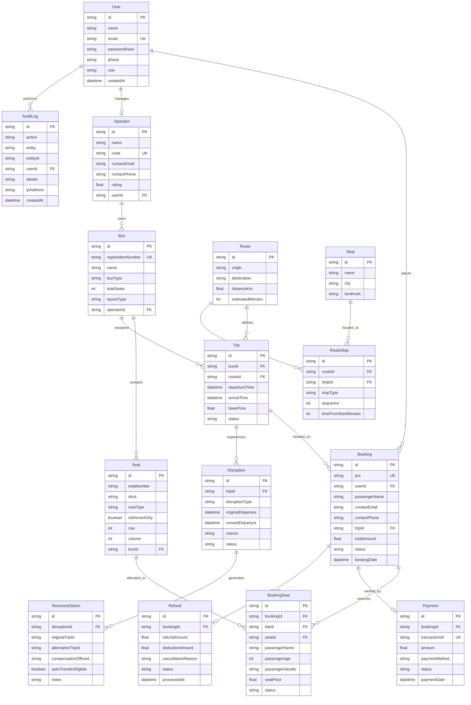

# Rova Database Schema & Entity-Relationship Architecture

This document provides the comprehensive relational schema, indexes, unique constraints, and Mermaid ER diagram for the **Rova Bus Booking Management System** as specified for the ALGIONS AI LABS assessment.

---

## 1. Mermaid Entity-Relationship (ER) Diagram

---

## 2. Table Specifications & Indexes

| Table | Primary Key | Key Foreign Keys | Unique Constraints & Indexes | Purpose |
| :--- | :--- | :--- | :--- | :--- |
| `users` | `id` | — | `email` (UNIQUE) | Manages authentication, hashed passwords, and RBAC roles (`PASSENGER`, `OPERATOR`, `ADMIN`). |
| `operators` | `id` | `userId` | `code` (UNIQUE), `userId` (UNIQUE) | Agency profiles, contact details, quality ratings. |
| `buses` | `id` | `operatorId` | `registrationNumber` (UNIQUE) | Fleet vehicles, seating configuration (`2x2`, `2x1`), model info. |
| `seats` | `id` | `busId` | `[busId, seatNumber, deck]` (UNIQUE) | Physical seat layout matrix with deck, category, women-preference. |
| `routes` | `id` | — | `[origin, destination]` (UNIQUE) | Intercity corridors with distance and baseline travel duration. |
| `stops` | `id` | — | — | Boarding/dropping stations with city and landmarks. |
| `route_stops` | `id` | `routeId`, `stopId` | `[routeId, stopId]` (UNIQUE) | Ordered sequence of stations on a route. |
| `trips` | `id` | `busId`, `routeId` | Indexed by `departureTime`, `routeId`, `status` | Scheduled departures, base pricing, schedule health. |
| `bookings` | `id` | `userId`, `tripId` | `pnr` (UNIQUE) | Confirmed customer reservations and master contact details. |
| `booking_seats` | `id` | `bookingId`, `seatId`, `tripId` | `[bookingId, seatId]` (UNIQUE), Index on `[tripId, seatId, status]` | Individual seat reservations ensuring concurrency prevention. |
| `payments` | `id` | `bookingId` | `transactionId` (UNIQUE), `bookingId` (UNIQUE) | Payment authorization and transaction reference audit trail. |
| `refunds` | `id` | `bookingId` | `bookingId` (UNIQUE) | Refund accounting, policy deduction breakdowns, and timestamps. |
| `disruptions` | `id` | `tripId` | Indexed by `tripId`, `status` | Operational delays, cancellations, and depot inspection records. |
| `recovery_options` | `id` | `disruptionId` | Indexed by `disruptionId` | Alternative journeys and passenger goodwill vouchers. |
| `audit_logs` | `id` | `userId` | Indexed by `action`, `entity`, `createdAt` | Immutable log of material system events. |
